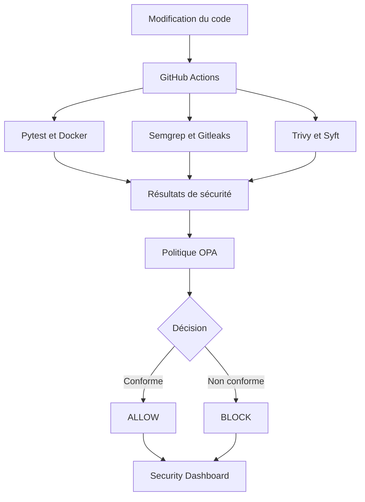

# SecureChain DevSecOps

SecureChain est un projet DevSecOps développé autour de **SecureShop**, une application web FastAPI conteneurisée.

Son objectif est d’intégrer des contrôles automatisés de qualité et de sécurité dans le cycle de développement, puis d’utiliser **Open Policy Agent (OPA)** comme Security Gate pour accepter ou bloquer une modification.

[](https://github.com/saiedaya500-cmd/securechain-devsecops/actions/workflows/ci.yml)
[](https://github.com/saiedaya500-cmd/securechain-devsecops/actions/workflows/semgrep.yml)
[](https://github.com/saiedaya500-cmd/securechain-devsecops/actions/workflows/opa.yml)

## Objectif du projet

Chaque modification du code est automatiquement testée et analysée avec GitHub Actions.

Les résultats sont transmis à une politique OPA qui retourne une décision finale :

- `ALLOW` lorsque tous les contrôles requis sont validés ;
- `BLOCK` lorsqu’un contrôle de sécurité échoue.

## Architecture DevSecOps



## Application SecureShop

SecureShop est une application de gestion de produits de cybersécurité.

Fonctionnalités principales :

- affichage du catalogue ;
- recherche par nom ou catégorie ;
- ajout, modification et suppression de produits ;
- gestion des quantités ;
- affichage des états `Disponible`, `Stock faible` et `Rupture` ;
- validation des données avec FastAPI ;
- protection CSRF des formulaires ;
- persistance des données avec SQLite ;
- interface responsive ;
- endpoint de santé `/health` ;
- documentation OpenAPI `/docs`.

## Contrôles de sécurité

| Outil | Fonction |
|---|---|
| Pytest | Exécute les tests fonctionnels |
| Semgrep | Réalise l’analyse statique du code |
| Gitleaks | Recherche les secrets exposés |
| Trivy | Analyse les dépendances et l’image Docker |
| Syft | Génère un SBOM CycloneDX |
| Docker | Exécute l’application avec un utilisateur non-root |
| OPA | Retourne la décision finale `ALLOW` ou `BLOCK` |

## Politique OPA

La pipeline est autorisée uniquement lorsque :

- les tests Pytest réussissent ;
- aucun secret n’est détecté ;
- aucune vulnérabilité `HIGH` n’est détectée ;
- aucune vulnérabilité `CRITICAL` n’est détectée ;
- le SBOM est correctement généré ;
- le conteneur ne fonctionne pas avec l’utilisateur root.

La politique est disponible dans :

```text
policy/securechain.rego
```

## Security Dashboard

Le Security Dashboard récupère les derniers résultats de GitHub Actions et affiche :

- la décision globale de sécurité ;
- les contrôles réussis ;
- les contrôles échoués ;
- les contrôles en attente ;
- l’état de chaque workflow ;
- les liens vers les exécutions GitHub Actions ;
- la branche et le dernier commit analysé.

Accès local :

```text
http://127.0.0.1:8000/security-dashboard
```

## Technologies utilisées

- Python
- FastAPI
- SQLAlchemy
- SQLite
- Jinja2
- HTML et CSS
- Bootstrap
- Docker
- GitHub Actions
- Pytest
- Semgrep
- Gitleaks
- Trivy
- Syft
- CycloneDX
- Open Policy Agent
- GitHub REST API

## Installation locale

### Windows PowerShell

```powershell
python -m venv .venv
.\.venv\Scripts\Activate.ps1
python -m pip install -r requirements-dev.txt
python -m uvicorn app.main:app --reload
```

### Linux

```bash
python3 -m venv .venv
source .venv/bin/activate
python -m pip install -r requirements-dev.txt
python -m uvicorn app.main:app --reload
```

Ouvrir ensuite :

- catalogue : `http://127.0.0.1:8000/`
- Security Dashboard : `http://127.0.0.1:8000/security-dashboard`
- documentation API : `http://127.0.0.1:8000/docs`

## Exécution avec Docker

```bash
docker build -t secureshop:local .
docker run --rm -p 8000:8000 secureshop:local
```

## Exécution des tests

```bash
python -m pytest -q
```

## Structure du projet

```text
securechain-devsecops/
├── .github/workflows/     # Workflows GitHub Actions
├── app/                   # Application FastAPI
│   ├── static/            # Fichiers CSS
│   └── templates/         # Templates HTML
├── policy/                # Politique et tests OPA
├── scripts/               # Génération des entrées OPA
├── tests/                 # Tests Pytest
├── Dockerfile
└── requirements-dev.txt
```

## Protection de la branche principale

La branche `main` est protégée par un ruleset GitHub.

Les nouvelles modifications sont développées dans des branches séparées et intégrées au moyen d’une Pull Request. Cette organisation permet d’exécuter les contrôles automatisés avant la fusion.

## Améliorations futures

- authentification et gestion des rôles ;
- rate limiting ;
- déploiement cloud ;
- supervision de sécurité à l’exécution ;
- tests supplémentaires du dashboard et des erreurs de l’API.

## Auteur

**Aya Saied**

Étudiante ingénieure en cybersécurité.

GitHub : [saiedaya500-cmd](https://github.com/saiedaya500-cmd)